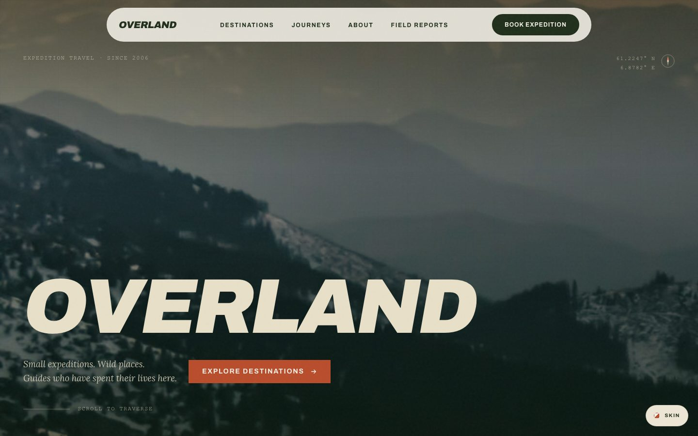

# OVERLAND — free Astro template for adventure and expedition travel

A field-report style website for expedition outfitters, mountain and polar
guides, and outdoor brands that sell trips. Built with Astro, React islands,
Tailwind CSS v4 and GSAP. Free and open source under the MIT License.

**Live demo:** https://fpsjago.github.io/overland/



---

## Features

- **Panoramic scroll hero.** A 4:1 photograph drifts sideways as you scroll,
  while a GPS readout counts from the Norwegian fjords to Patagonia.
- **Pinned destinations rail** on desktop, and a native swipe rail on phones.
- **Three colour skins:** The Map (parchment and rust), Night Camp (dark) and
  Arctic (glacier blue). Switch them live, link one with `?skin=night`, and the
  visitor's choice is remembered.
- **12 page templates, 29 routes.** Home, destinations and detail pages,
  journeys with day-by-day itineraries, about, guides, field-report blog,
  contact form, FAQ and a "signal lost" 404.
- **Typed content.** Destinations, journeys, guides and blog posts are Astro
  content collections with Zod schemas, so a typo fails the build instead of
  shipping.
- **Fast by default.** Self-hosted fonts, inlined CSS, responsive AVIF/WebP
  images generated at build time, and smooth-scroll libraries loaded only when
  the visitor starts moving.
- **Accessible.** WCAG AA contrast in all three skins, a skip link, visible
  focus rings, a keyboard-friendly mobile menu, and a full
  `prefers-reduced-motion` mode.
- **Real photography.** Every image is a credited Pexels photo, with no
  placeholders and no AI images.

### Lighthouse

Measured on the production build with a GitHub Pages-style server (gzip),
Lighthouse 13.5, 14 routes.

| | Desktop | Mobile |
|---|---|---|
| Performance | 100 on every route | 93–97 |
| Accessibility | 100, all three skins | 100, all three skins |
| Best practices | 100 | 100 |
| SEO | 100 | 100 |

---

## Quick start

Requires **Node 20 or newer**.

```bash
git clone https://github.com/fpsjago/overland.git
cd overland
npm install
npm run dev       # http://localhost:4321/overland/
npm run build     # static site in dist/
npm run preview   # serve the build locally
```

The dev URL includes `/overland/` because `base` is set in `astro.config.mjs`.
Deploying to a domain root? Remove `base` there. `DEPLOYMENT.md` covers GitHub
Pages, Vercel and Netlify.

---

## Make it yours

Everything is documented in **[CUSTOMIZATION.md](CUSTOMIZATION.md)**. Start with
these:

| To change | Edit |
|---|---|
| Colours and skins | `src/styles/global.css` (default palette) and `src/styles/skins.css` |
| Fonts | `src/assets/fonts/` and the `@font-face` rules at the top of `global.css` |
| Destinations, journeys, guides, posts | `src/content/` (JSON and Markdown) |
| Photos | drop files into `src/assets/images/` and keep the file names |
| Navigation and footer | `src/components/Nav.tsx`, `src/components/Footer.tsx` |
| Site URL, SEO, structured data | `astro.config.mjs`, `src/layouts/BaseLayout.astro` |

All copy is sample content for a fictional operator. The gear-partner names in
`src/components/PartnersMarquee.tsx` are fictional placeholders for your own
partners. Then read
**[IMAGE-CREDITS.md](IMAGE-CREDITS.md)**: the photos are under the Pexels
Licence, not MIT.

---

## Stack

| Package | Version |
|---|---|
| `astro` | ^5.17 |
| `react` / `react-dom` | ^19.2 |
| `tailwindcss` / `@tailwindcss/vite` | ^4.2 |
| `gsap` | ^3.14 |
| `lenis` | ^1.3 |
| TypeScript | strict, no `any` |

```
src/
├── assets/          fonts and photos (optimised at build time)
├── components/      React components (.tsx)
├── content/         destinations, journeys, guides, blog
├── layouts/         BaseLayout.astro: head, SEO, skins, smooth scroll
├── lib/             base-path helper, formatting, responsive images
├── pages/           12 route files
├── styles/          global.css (tokens, components), skins.css
└── types/           shared TypeScript types
```

Only the components that need the browser are hydrated: the navigation and
cursor when the page goes idle, and the stats bar and destinations rail as they
approach the viewport. Everything else ships as plain HTML.

---

## More templates

OVERLAND is one of the templates made by **FSEVO**. Browse the rest at
**https://www.fullstackevolved.com/templates/**.

## License

Code: [MIT](LICENSE.md) © 2026 FULLSTACK EVOLVED LLC. Photographs: Pexels
Licence (see [IMAGE-CREDITS.md](IMAGE-CREDITS.md)). Fonts: SIL Open Font
License 1.1.
